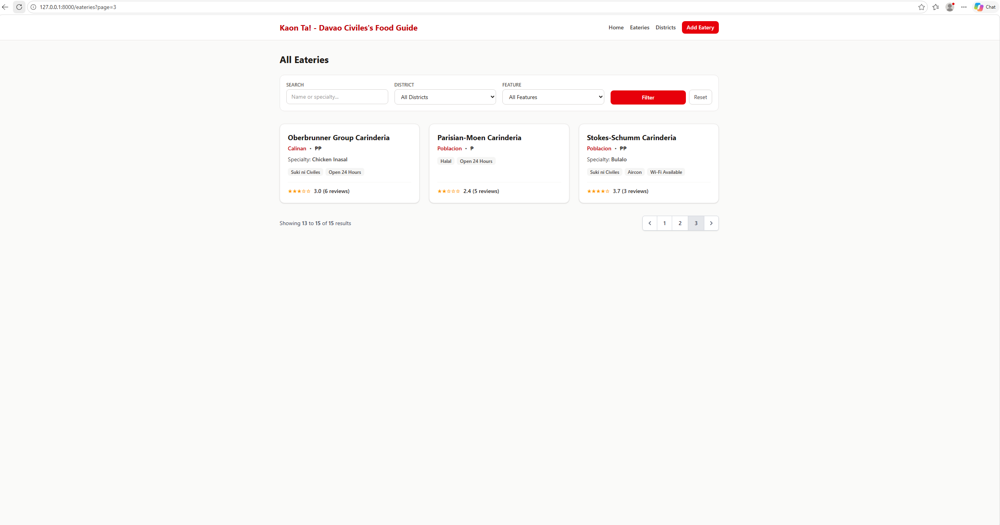
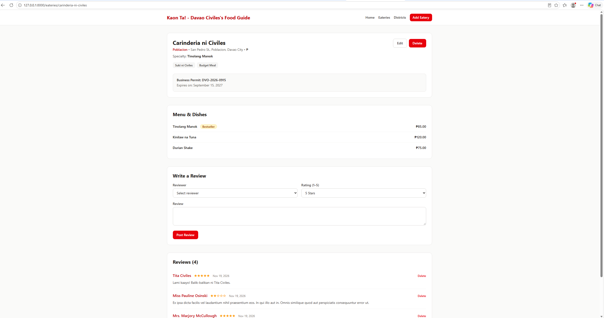
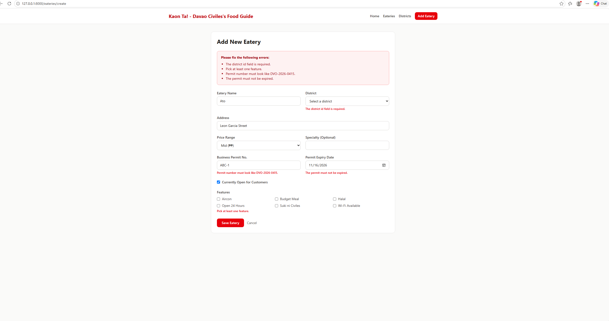

# Kaon Ta! Davao Civiles's Food Guide

**Author:** Christian Civiles  
**Course:** 4-334 CS Elective 2 — Full-Stack Development (Laravel)  
**Repository:** `PrefinalProject-Civiles-KaonTaDavao`

A public Laravel 12 and SQLite web directory for the Davao City Tourism Office that catalogs carinderias and local eateries by district, tracks business permits, showcases dishes and amenities, and collects resident reviews.

---

## Setup Instructions

Run the following commands on a fresh clone to install dependencies, initialize SQLite, seed the database, compile Vite assets, and start the local server:

```bash
composer install
cp .env.example .env
php artisan key:generate
touch database/database.sqlite
php artisan migrate:fresh --seed
npm install
npm run build
php artisan serve
# or npm run dev while developing
```

---

## Personalized Seed Data

| Item | Value |
| :--- | :--- |
| **Districts (6)** | `Poblacion`, `Talomo`, `Agdao`, `Buhangin`, `Toril`, `Calinan` |
| **Features (6)** | `Suki ni Civiles`, `Budget Meal`, `Halal`, `Open 24 Hours`, `Aircon`, `Wi-Fi Available` |
| **Seeded User 1** | `Christian Civiles` (`civiles@kaonta.test` / password: `kaonta2026`) |
| **Seeded User 2** | `Tita Civiles` (`tita.civiles@kaonta.test` / password: `kaonta2026`) |
| **Hand-Made Eatery** | `Carinderia ni Civiles` (slug: `carinderia-ni-civiles`, District: `Poblacion`, Address: `San Pedro St., Poblacion, Davao City`, Price Range: `budget`, Specialty: `Tinolang Manok`) |
| **Eatery Features** | `Suki ni Civiles`, `Budget Meal` |
| **Business Permit** | `DVO-2026-0915` (Expires: `2027-09-15`) |

---

## Eloquent Relationships

| Relationship | Type (Both Directions) | Why This Relationship Fits |
| :--- | :--- | :--- |
| **District ↔ Eatery** | `hasMany` / `belongsTo` | One Davao City district contains many local eateries, while each eatery is located in a single district via `district_id`. |
| **Eatery ↔ Dish** | `hasMany` / `belongsTo` | An eatery serves multiple menu dishes, and every dish belongs exclusively to the eatery that prepares it. |
| **Eatery ↔ Review** | `hasMany` / `belongsTo` | Residents can submit many reviews for a single eatery, while each review evaluates one specific eatery. |
| **User ↔ Review** | `hasMany` / `belongsTo` | One resident user can write multiple reviews across different eateries, and each review is authored by a single user. |
| **Eatery ↔ Permit** | `hasOne` / `belongsTo` | Each eatery is issued exactly one unique business permit record (`eatery_id` unique), and every permit belongs to one eatery. |
| **Eatery ↔ Feature** | `belongsToMany` / `belongsToMany` (pivot: `eatery_feature`) | An eatery can offer several amenities (such as Halal or Aircon) at once, and each feature tag applies to many eateries across the city. |
| **District → Review** | `hasManyThrough` (via `Eatery`) | Reviews do not store `district_id` directly, so `hasManyThrough` lets a district aggregate and count all reviews belonging to its eateries in one query path. |

---

## Route List (`php artisan route:list --except-vendor`)

```text
  GET|HEAD        / ................................................................................................................................ home › HomeController
  GET|HEAD        districts ................................................................................................... districts.index › DistrictController@index
  GET|HEAD        districts/{district} .......................................................................................... districts.show › DistrictController@show
  GET|HEAD        eateries ....................................................................................................... eateries.index › EateryController@index
  POST            eateries ....................................................................................................... eateries.store › EateryController@store
  GET|HEAD        eateries/create .............................................................................................. eateries.create › EateryController@create
  GET|HEAD        eateries/{eatery} ................................................................................................ eateries.show › EateryController@show
  PUT|PATCH       eateries/{eatery} ............................................................................................ eateries.update › EateryController@update
  DELETE          eateries/{eatery} .......................................................................................... eateries.destroy › EateryController@destroy
  GET|HEAD        eateries/{eatery}/edit ........................................................................................... eateries.edit › EateryController@edit
  POST            eateries/{eatery}/reviews .............................................................................. eateries.reviews.store › ReviewController@store
  GET|HEAD        reviewers/{user} .............................................................................................. reviewers.show › ReviewerController@show
  DELETE          reviews/{review} ............................................................................................ reviews.destroy › ReviewController@destroy

                                                                                                                                                       Showing [13] routes
```

---

## Screenshots

### 1. Eatery List (`/eateries`)


### 2. Eatery Details & Reviews (`/eateries/carinderia-ni-civiles`)


### 3. Create Eatery Form with Validation Errors (`/eateries/create`)
